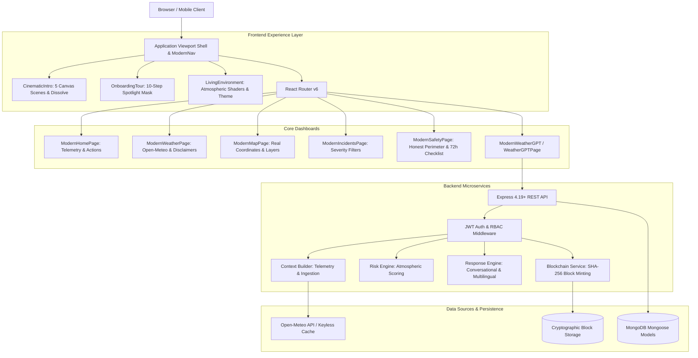
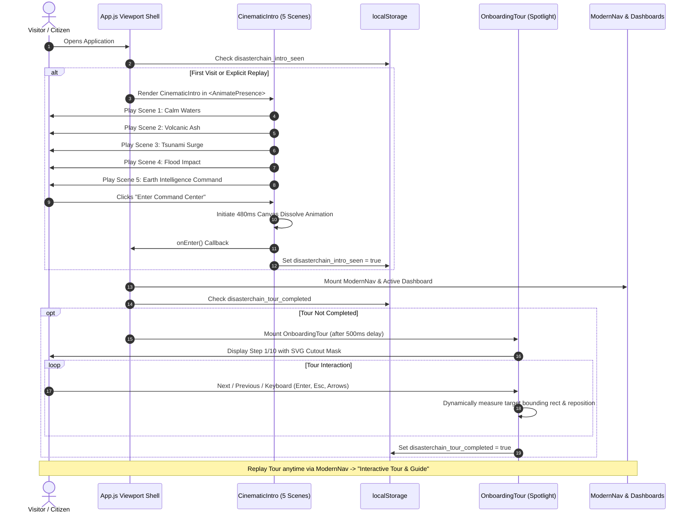
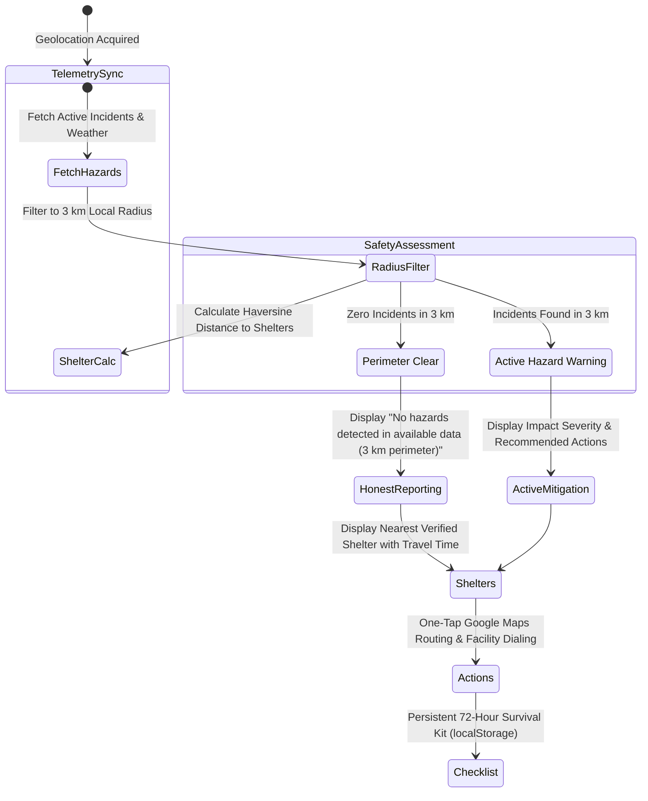

# DisasterChain Architecture & System Design 🚨⛓️

> **Production-Grade Disaster Intelligence, Personal Safety & Transparency Ledger**

This document details the complete end-to-end architecture, lifecycle flows, data pipeline, and UX engineering of DisasterChain following the complete UX, intelligence, and architectural upgrade.

---

## 1. High-Level System Architecture

DisasterChain is designed around five interconnected architectural pillars:
1. **Interactive Experience Shell**: Cinematic canvas prologue, persistent living atmospheric environment, and interactive 10-step guided tour.
2. **Core Operational Dashboards**: Telemetry overview, micro-strip live metrics, Leaflet 2D spatial mapping, and crowdsourced incident response.
3. **Conversational Weather & Hazard Intelligence (WeatherGPT)**: Hybrid neural-deterministic NLP engine with automated telemetry extraction, localized risk scoring, and zero-dependency markdown rendering.
4. **Grounded Personal Safety & SOS Subsystem**: Honest perimeter analysis, nearest shelter routing, persistent offline 72-hour checklist, and emergency dispatch.
5. **Cryptographic Transparency Ledger**: Immutable SHA-256 block receipts ensuring zero humanitarian aid diversion.



---

## 2. Navigation, Cinematic Intro & Tour Lifecycle

The transition from initial visitor arrival to active platform operation is carefully orchestrating user immersion, orientation, and access:



---

## 3. WeatherGPT Conversational Intelligence Pipeline

WeatherGPT delivers instant weather-hazard answers and clothing/safety recommendations without exposing raw markdown markup or leaky backend state.

```mermaid
flowchart TD
    Query[User Weather / Hazard Query] --> UI[ModernWeatherGPT Component]
    UI --> Context[WeatherGPTContext]
    Context --> API[POST /api/weather/chat]
    
    API --> Intent[Intent & Entity Classifier]
    Intent --> LocExtract[Location Resolution: GPS or Named City]
    LocExtract --> Telemetry[Context Builder: Fetch Live Open-Meteo Data]
    
    Telemetry --> FallbackCheck{Telemetry Available?}
    FallbackCheck -- Yes --> Ingest[Extract Temp, Pressure, Wind, AQI, Precip]
    FallbackCheck -- No --> FallbackIngest[Synthesize Honest Telemetry Fallback]
    
    Ingest --> Risk[Risk Engine: Calculate Severity & Hazard Flags]
    FallbackIngest --> Risk
    
    Risk --> AI{AI Provider (Gemini) Available?}
    AI -- Yes --> GeminiPrompt[System Prompt with Telemetry & Ground Rules]
    GeminiPrompt --> NaturalResp[Natural Conversational Output]
    AI -- No / Timeout --> DetEngine[Deterministic Response Engine]
    
    DetEngine --> IntentTemplates[Safe Intent Template Mapping: Clothing, Rain, etc.]
    IntentTemplates --> NaturalResp
    
    NaturalResp --> SafetyGuard[Emergency Guard: Life-Safety "Call 112" Intercept]
    SafetyGuard --> Payload[JSON Payload with Reply, Telemetry, Actions]
    
    Payload --> UI
    UI --> MD[MarkdownRenderer Component]
    MD --> DOM[Formatted Typography: Bold, Lists, Code, Links]
```

### Key Safety & Engineering Safeguards in WeatherGPT:
1. **Zero Undefined Leaks**: Fallback chaining (`pressureHpa: current.pressureHpa ?? current.pressureMsl ?? 1013`) guarantees numerical stability.
2. **Conversational Directness**: Clothing inquiries are answered immediately and practically (e.g., *"No jacket needed right now in New Delhi at 26.4°C."*) instead of raw technical tables.
3. **Emergency Interception**: Distress triggers automatically elevate responses with a clear emergency disclaimer, direct hotline recommendation (Call 112), and interactive SOS dispatch actions.
4. **Safe Markdown Rendering**: `MarkdownRenderer.jsx` tokenizes headers, inline styles, bullet points, and code spans without external heavy dependencies or DOM injection vulnerabilities (`dangerouslySetInnerHTML` is avoided for user-generated strings).

---

## 4. Grounded Personal Safety & SOS Dispatch Subsystem

Personal safety recommendations are scientifically grounded in empirical data rather than synthetic claims:



---

## 5. Core Dashboard Architecture & Space Utilization

Every core view provides purposeful, live intelligence:

| Page | Key Components & Upgrades | Grounded Data Behavior |
| :--- | :--- | :--- |
| **`ModernHomePage.jsx`** | Data freshness timestamp, Telemetry micro-strip, dynamic "What Should I Do Next?" card, Leaflet 2D incident pins, active alert banner. | Shows real station observation timestamps; never reports synthetic mock incident counts. |
| **`ModernSafetyPage.jsx`** | Honest perimeter assessment, real nearest shelter calculation (Haversine km & min travel time), responsive emergency contacts grid, persistent 72h survival checklist. | Acknowledges sensor/data limits: states *"No hazards detected in available data"* rather than absolute certainty. |
| **`ModernWeatherPage.jsx`** | Live Open-Meteo metrics, practical recommendations (clothing, outdoors, travel), data source attribution footnote, scientific disclaimer. | Explicitly attributes Open-Meteo atmospheric models and IMD alerts. |
| **`ModernMapPage.jsx`** | Leaflet container, dynamic marker parsing, geolocation centering, layer toggle (All, Critical, Moderate). | Parses real numeric lat/lng from backend; excludes synthetic random jitter. |
| **`ModernIncidentsPage.jsx`** | Filter pills (`ALL`, `VERIFIED`, `CRITICAL`), real incident cards with verification badges, intelligent empty state, incident report modal. | Responsive grid with empty-state guidance and quick reporting shortcut. |

---

## 6. Verification Suite & Quality Assurance

The platform adheres to strict automated testing standards:

| Test Suite | Scope | Target | Result |
| :--- | :--- | :--- | :--- |
| `test_weather_gpt_2_suite.js` | Backend WeatherGPT & Intent Engine | 20 Cases (Telemetry honesty, no undefined, clothing, life-safety) | **20/20 PASSED ✓** |
| `test_weather_gpt_suite.js` | Comprehensive WeatherGPT Integration | 30 Cases (Locations, Hindi/Urdu, RBAC, zero secrets, payloads) | **30/30 PASSED ✓** |
| `App.test.js` | Frontend Unit & Regression Suite | 14 Tests (Smoke, intro bypass, theme tokens, MarkdownRenderer, Tour) | **14/14 PASSED ✓** |
| `npm run build` | Frontend Production Compilation | Zero errors, optimized code splitting, strict bundle integrity | **SUCCESS ✓** |

---

## 7. Accessibility, Theming & Keyboard Controls

- **Onboarding Tour**: Fully navigable via keyboard (`Escape` to dismiss, `Enter` / `Space` to advance, `ArrowLeft` / `ArrowRight` to step through).
- **Living Atmospheric Theme**: Dark and light modes with high-contrast borders (`var(--border)`, `var(--text-primary)`, `var(--bg-glass)`).
- **Responsive Viewport Support**: Certified across mobile viewports (360px, 390px, 412px), tablets (768px, 834px), and desktop displays (1024px, 1440px+).
